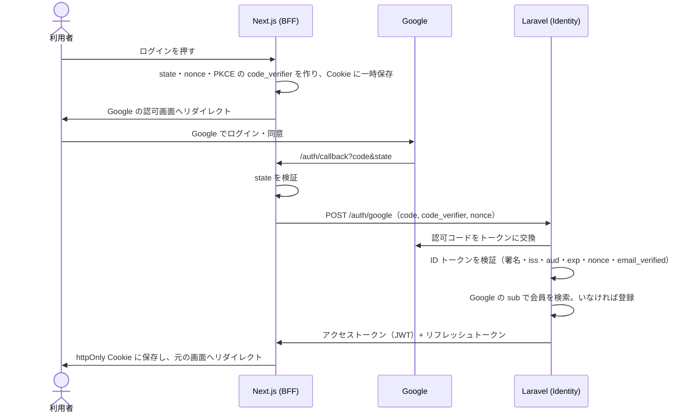
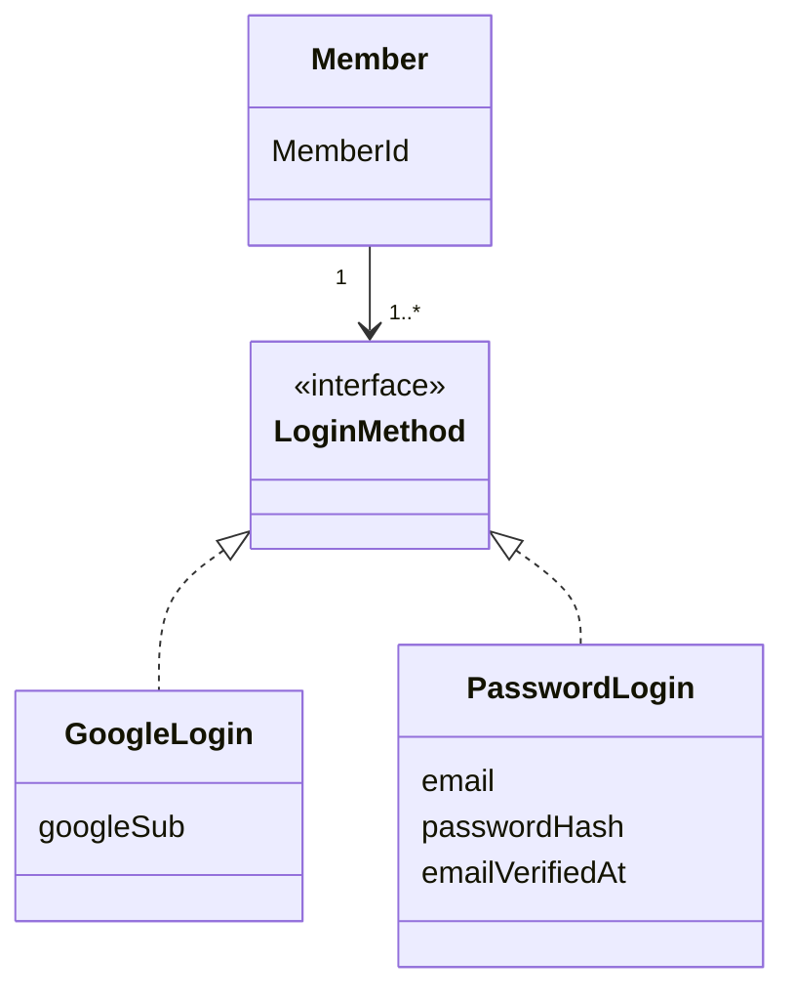

# 認証・認可

決定の理由は [ADR-0005](../adr/0005-authentication.md)。

## 方針

- ログイン手段は **Google（OpenID Connect）** と **メールアドレス + パスワード**の2つ。Apple ログインは作らない。
- Laravel（Identity コンテキスト）が会員とトークンを管理する。Laravel Sanctum は使わない。
- Laravel は **JWT のアクセストークン**と**リフレッシュトークン**を発行する。
- トークンは Next.js（BFF）が **httpOnly Cookie** で保持する。ブラウザの JavaScript からは読めない。

## Google ログインの流れ

- Google ログインでは、Google の `sub`（変わらない ID）で本人を識別する。Google 側のメールアドレスは変わる可能性があるので識別に使わない。
- Google のトークン（アクセストークンなど）は保存しない。本人確認にだけ使う。

## トークン

| | アクセストークン | リフレッシュトークン |
|---|---|---|
| 形式 | JWT（非対称鍵で署名。アルゴリズムは実装時に決める） | ランダムな文字列（256bit 以上） |
| 有効期限 | 15分 | 30日 |
| 保存場所（サーバー） | 保存しない | DB にハッシュ値だけ保存 |
| 保存場所（ブラウザ） | httpOnly・Secure・SameSite=Lax の Cookie | 同左。proxy で読むため Path は `/`（Laravel へ送るのは更新のときだけ） |
| 中身 | `sub`（会員 ID）、`roles`、`iss`、`aud`、`exp`、`iat`、`jti` | なし |

- **ローテーション**: リフレッシュするたびに新しいリフレッシュトークンを発行し、古いものを無効にする。
- **同時リクエストの扱い**: アクセストークンの期限切れ時は、複数のリクエストが同じリフレッシュトークンで同時に更新しに来る。Laravel は系列の行を排他的に取得して更新を直列化する。ローテーションから10秒以内（猶予時間）の直前のトークンは再利用として扱わず、**新しいアクセストークンだけ**を返す（リフレッシュトークンは発行しない）。
- **再利用の検知**: 上記の猶予時間を過ぎて、無効にしたリフレッシュトークンが使われたら盗まれたとみなし、同じ系列のトークンを全て無効にする。猶予時間内に盗まれたトークンが使われた場合に得られるのは、最大15分のアクセストークンだけで、系列は引き継げない。
- **ログアウト**: リフレッシュトークンの系列を無効にし、Cookie を削除する。アクセストークンは最大15分残るが、短い有効期限で許容する。
- アクセストークンが切れていたら、Next.js の middleware（Next.js 16 では `proxy`）でリフレッシュする。Server Components は Cookie を書き換えられないため、更新をそこで行わない。
- proxy で更新したら、ブラウザへのレスポンスの `Set-Cookie` に加えて、**後続に渡すリクエストの Cookie も新しい値に置き換える**。置き換えないと、同じリクエストの Server Components は期限切れのトークンを読んでしまう。
- JWT の署名検証では、許可するアルゴリズムを固定する（`alg: none` や別アルゴリズムへのすり替えを防ぐ）。

## Laravel 側の構成（教材に合わせる）

- ユースケース層（全コンテキストで使うので `modules/Shared/UseCase`）に「ログイン中の会員の情報」を表す interface（`UserSession` 相当）を定義し、ユースケースの引数で受け取る（教材: サンプルコード&FAQ 第8章 8.3.1）。
- JWT を検証して `UserSession` を作る処理はプレゼンテーション層に置く。ユースケースは JWT や Cookie を知らない。
- 認証のためのクラスと、ドメインの会員の集約は分ける（教材: サンプルコード&FAQ 第8章 8.3.2）。

## 認可

- ロールは `customer` と `admin` の2つから始める。
- 管理者の付与方法（初期データで付与 / 許可したメールアドレスのみ など）は Identity のモデリング時に決める。
- 「自分の注文しか見られない」などのルールは、ユースケースで `UserSession` を使って確認する。

## CSRF・その他

- 更新系の Route Handler は `Origin` ヘッダが自サイトか確認する。Server Actions は Next.js が確認する。
- ログイン・トークン更新の API にレート制限をかける。
- `state` と `nonce` は1回使ったら破棄する。

## パスワードログイン

**Identity コンテキストの「ログイン手段」の1つ**として作る。トークンの発行・更新・ログアウトは Google と共通にし、変わるのは「本人確認」の部分だけにする。

流れ: ブラウザ → Next.js（Server Action / Route Handler）→ Laravel の `POST /auth/login` → 本人確認に成功したらトークンを発行 → Next.js が httpOnly Cookie に保存する。

（モデルの形は例。実際のモデルは開発者本人が決める）

必要になるもの:

| 項目 | 内容 |
|---|---|
| 画面・API | 登録、メール確認、ログイン、パスワード再設定の依頼、再設定、パスワード変更 |
| ハッシュ | Argon2id（Laravel の `Hash`）。ハッシュ処理は infra に置き、ドメインには interface だけ置く |
| メール確認 | 確認するまでログインさせない。確認用トークンは1回限り・期限つき・ハッシュで保存 |
| パスワード再設定 | トークンは1回限り・30分程度・ハッシュで保存。再設定したらリフレッシュトークンを全て無効にする |
| 総当たり対策 | IP とメールアドレスの組み合わせでレート制限。一定回数失敗したら一時的にロック |
| アカウントの存在を漏らさない | 「メールアドレスかパスワードが違います」など、どちらが違うか分からない文言にする。再設定の依頼も、登録の有無で応答を変えない |
| Google ログインとの紐付け | **メールアドレスが同じでも自動で紐付けない**（乗っ取りの原因になる）。ログインした状態で、設定画面から手段を追加する |
| 追加の対策（MVP の後で検討） | 漏洩したパスワードの拒否（Have I Been Pwned の k-匿名性 API）、2段階認証 |

同じメールアドレスで別の手段から登録しようとした場合の扱いは、Identity のモデリング時に決める。
