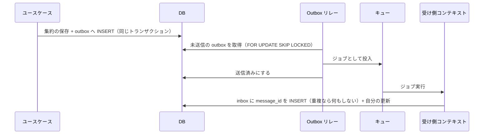

# 整合性・並行処理・非同期処理

このプロジェクトで一番学びたい部分。トランザクション、ロック、イベントソーシング、キューの使い分けを決める。
業務上の答え（在庫をいつ減らすか、など）はモデリングで決める（[modeling/README.md](../modeling/README.md#モデリングで決めること技術側から見た論点)）。ここで決めるのは技術的なルールだけ。

## 1. トランザクション

- **ユースケースのメソッドの入口で開始し、正常に終わればコミット、例外ならロールバックする**（教材: サンプルコード&FAQ 第8章 8.5.7）。
- ユースケース層は `TransactionManager` interface（`modules/Shared/UseCase`）に依存し、Laravel の `DB::transaction` を使う実装は infra に置く。ユースケースの単体テストではトランザクションを何もしない Fake に差し替える。
- リポジトリやドメインサービスの中でトランザクションを開始しない。
- トランザクションの中で外部 API（Stripe など）を呼ばない。外部 API は、トランザクションの前に呼ぶか、コミット後のジョブで呼ぶ。

## 2. 複数集約の更新

| 範囲 | ルール |
|---|---|
| 同じコンテキストの複数集約 | 1つのユースケースで1トランザクションにまとめてよい（教材: サンプルコード&FAQ 第5章 5.2.1）。ただし、同時に更新することが多いなら集約の境界を見直す |
| コンテキストをまたぐ更新 | **1トランザクションにしない**。統合イベントを Outbox で発行し、受け側が自分のトランザクションで更新する（結果整合性） |

## 3. ロック

### 3.1 楽観ロック（同時編集を検出する）

- 対象: 管理者による商品・価格の編集など、衝突が少なく、衝突したらやり直せば済む更新。
- テーブルに `version` 列を持ち、`UPDATE ... WHERE id = ? AND version = ?` の更新件数が0なら競合として扱う。
- ドメインへの漏れは最小にする: `modules/Shared/Domain` に「楽観ロックできる」ことを表す interface とバージョンの値オブジェクトを置き、集約がそれを実装する（教材: サンプルコード&FAQ 第3章 3.3.2）。
- 競合したら `409 Conflict` を返し、利用者に再読み込みしてもらう。自動でリトライしない。

### 3.2 悲観ロック（同時更新をさせない）

- 対象: 在庫の引き当てなど、衝突が多く、後勝ちや失敗を許したくない更新。
- リポジトリの interface には「排他的に取得する」ことだけを表す（例: `findByIdExclusively()`）。`lock` や `forUpdate` など DB の用語をドメイン層に出さない（教材: サンプルコード&FAQ 第4章 4.1.6）。
- 実装（infra）で `SELECT ... FOR UPDATE` を使う。
- **デッドロックを防ぐため、複数行をロックするときは必ず ID の昇順で取得する。**
- ロック待ちの上限を設定する（PostgreSQL は `lock_timeout`、MySQL は `innodb_lock_wait_timeout`）。上限を超えたら失敗として扱い、待ち続けない。
- デッドロック・ロック待ちタイムアウトのときだけ、ユースケースの外側で最大3回までリトライする（間隔はランダムに少しずつ伸ばす）。

### 3.3 条件付き UPDATE（ロックを取らない書き方）

- `UPDATE stocks SET available = available - :n WHERE id = :id AND available >= :n` のように、1文で確認と更新を行う方法もある。
- 悲観ロックと比べて速いが、ドメインのルールが SQL に移る。**どちらを使うかは、在庫のモデルを決めた後に比較し、ADR に残す**（両方実装して並行テストで比べるのが学習としておすすめ）。

### 3.4 ロックの検証

ロックを使う処理は、**並行実行テスト**で検証する（[testing.md](../engineering/testing.md#並行実行テスト)）。単体テストが通っても、ロックが正しいことは確認できない。

## 4. イベントソーシング

適用する集約は [ADR-0004](../adr/0004-event-sourcing-scope.md) で決める（仮: Ordering の注文）。それ以外の集約は状態をそのまま保存する。

### 4.1 イベントストア（自作）

```text
event_store
  global_position  bigint 連番（読み取りモデル更新の順番に使う）
  stream_id        uuid       集約の ID
  stream_type      text       集約の種類（例: order）
  version          int        その集約の中での連番（1 から）
  event_type       text       例: order.placed
  event_version    int        イベントの形式のバージョン
  payload          json
  metadata         json       correlation_id / causation_id / 実行したユーザーなど
  occurred_at      timestamp
  UNIQUE (stream_id, version)
```

- **追記のみ**。UPDATE / DELETE をしない（DB ユーザーの権限かトリガーで禁止する）。
- **楽観的な並行制御**: 保存するときに「読み込んだ時点のバージョン」を渡し、`(stream_id, version)` の一意制約違反なら競合として扱う。
- 集約は「イベントを順に適用して状態を復元する」メソッドと「コマンドを受けて新しいイベントを返す」メソッドを持つ。状態の変更はイベントの適用でだけ行う。
- イベントは過去の事実なので、名前は過去形にする（`OrderPlaced`）。
- イベントの形式を変えるときは `event_version` を上げ、古い形式を読み込むときに変換する。保存済みのイベントは書き換えない。
- スナップショットは、イベント数が増えて読み込みが遅くなってから導入する（MVP では作らない）。

### 4.2 読み取りモデル（CQRS）

- 画面表示用の読み取りモデル（テーブル）を、イベントから作る（プロジェクション）。
- 参照系の処理は、ユースケース層に定義したクエリサービスの interface から読み取りモデルを読む（教材: モデリング/実装ガイド 第8章）。
- プロジェクションは `global_position` の順に処理し、どこまで処理したかを記録する。同じイベントを2回処理しても結果が変わらないように作る。
- 読み取りモデルは遅れて更新される。「注文直後の画面」で古い状態が見えてよいかは、画面ごとに決める。

## 5. ドメインイベントと統合イベント

| 種類 | 範囲 | 例 |
|---|---|---|
| ドメインイベント | コンテキストの中。イベントソーシングでは保存されるイベントそのもの | `OrderPlaced` |
| 統合イベント | コンテキストの外へ公開する。`Contract` に定義し、内部の形式と切り離す | `ordering.order_placed.v1` |

統合イベントは、他のコンテキストが依存してよい「約束」なので、壊す変更をするときはバージョンを上げて並行して発行する。

## 6. Outbox / Inbox



- 「DB へ保存したがキューへの投入に失敗した」を防ぐため、**キューへ直接投入しない**。必ず Outbox に書く。
- 配信は「少なくとも1回」。同じメッセージが2回届く前提で、受け側は Inbox（`message_id` の一意制約）で重複を捨てる。
- リレーは複数起動しても同じ行を取り合わないように `SKIP LOCKED` を使う。
- イベントソーシングの集約では、イベントストア自体を Outbox として使ってよい（`global_position` で未配信分を追う）。どちらにするかは実装時に ADR で決める。

## 7. キュー

ローカルは Redis + Laravel Queue（Horizon で監視）。将来 SQS へ差し替えられるよう、ジョブの中身はユースケースを呼ぶだけにする。

| 使う場所 | 理由 |
|---|---|
| 注文の受付 | アクセスが集中する箇所。API は受付だけ行って `202 Accepted` と受付 ID を返し、処理はワーカーで順に行う。画面は状態を確認して結果を表示する |
| Stripe Webhook | すぐに `2xx` を返さないと Stripe が再送する。受信・署名検証・保存だけ行い、処理はジョブで行う |
| Outbox のリレー・プロジェクション | 書き込みのレスポンスを遅くしない |
| メール送信 | 外部サービスの遅延を利用者に待たせない |

ジョブのルール:

- ジョブは**冪等**にする（同じジョブが2回動いても結果が同じ）。
- リトライ回数と間隔をジョブごとに明示する。上限を超えたら `failed_jobs` に残し、手動で調べられるようにする。
- キューは順番を保証しない前提で作る。順番が必要なら、イベントの `version` で判断する。
- ジョブに Eloquent モデルを渡さない。ID とメッセージだけ渡す。

## 8. 冪等性キー

- 注文など、二重に実行されると困る API は `Idempotency-Key` ヘッダを必須にする。キーと結果を保存し、同じキーなら前回の結果を返す。
- Stripe Webhook は Stripe のイベント ID を一意制約で保存し、2回目以降は処理しない。
- Stripe への決済作成リクエストにも冪等性キーを付ける。
