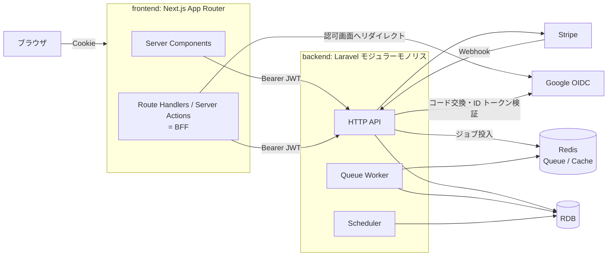
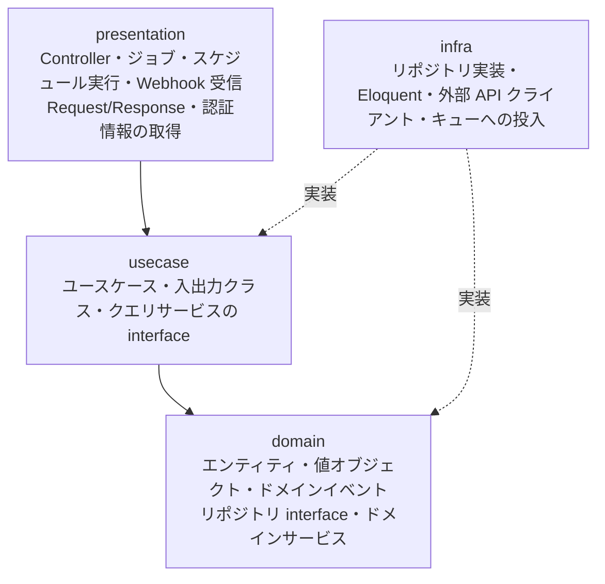

# システム構成

## 全体像



- **ブラウザは Next.js とだけ通信する**。Laravel API はブラウザから直接呼ばない（Stripe Webhook のエンドポイントだけ外部公開する）。
- Next.js は BFF として JWT を httpOnly Cookie で保持し、API 呼び出し時に `Authorization: Bearer` を付ける（[authentication.md](./authentication.md)）。
- Laravel は1つのアプリケーションの中に複数の境界づけられたコンテキストを持つ（[modules.md](./modules.md)）。
- API プロセスとキューワーカーは同じコードベースから別プロセスとして起動する。
- DB は PostgreSQL（[ADR-0003](../adr/0003-database.md)）。

## リポジトリ構成

```text
.
├── frontend/              # Next.js（App Router）
├── backend/               # Laravel
├── docs/
│   ├── product/           # 目的・スコープ・要求
│   ├── modeling/          # ドメインモデル図・ユビキタス言語
│   ├── architecture/      # 構成・モジュール・整合性・認証
│   ├── engineering/       # 開発フロー・規約・テスト・レビュー
│   └── adr/               # 意思決定の記録
├── .github/               # Issue / PR テンプレート、CI
├── compose.yaml           # ローカル開発環境（環境構築 Epic で作成）
├── AGENTS.md              # AI 向けルールの正本
└── CLAUDE.md              # AGENTS.md を読み込むだけ
```

理由は [ADR-0001](../adr/0001-monorepo.md)。

## バックエンドのレイヤー

教材に合わせ、**オニオンアーキテクチャ**を採用する（[ADR-0002](../adr/0002-modular-monolith-onion.md)）。



| 層 | 依存してよいもの | 禁止 |
|---|---|---|
| domain | 同じコンテキストの domain、`Shared/Domain`、PHP 標準 | Laravel（Facade・Eloquent・Collection 含む）、他の層、他のコンテキスト（`Contract` も含む） |
| usecase | 同じコンテキストの domain、`Shared/Domain`、`Shared/UseCase`、他コンテキストの `Contract` | presentation / infra、Eloquent、HTTP |
| presentation | 同じコンテキストの usecase、domain（ID の値オブジェクトの生成のみ）、`Shared/Domain`、`Shared/UseCase`、他コンテキストの `Contract`、Laravel | infra の具象クラス、Eloquent |
| infra | 同じコンテキストの domain、usecase の interface、`Shared` の全ての層、他コンテキストの `Contract`、Laravel、外部ライブラリ | presentation |

`Contract` と `Shared` は次のルールに従う。

| 対象 | 依存してよいもの | 補足 |
|---|---|---|
| `Contract` | PHP 標準、`Shared/Domain` | 自コンテキストの domain を公開しない。interface の実装は公開する側の infra に置く |
| `Shared/Domain` | PHP 標準 | Laravel とコンテキストに依存しない |
| `Shared/UseCase` | `Shared/Domain` | `TransactionManager`、`UserSession` などの interface を置く |
| `Shared/Infra` | `Shared/Domain`、`Shared/UseCase`、Laravel、外部ライブラリ | コンテキストに依存しない |

- 具象クラスの組み立て（DI のバインド）はコンテキストごとの ServiceProvider で行う。
- この表は Deptrac（または Pest の arch テスト）で CI が検査する（[coding-standards.md](../engineering/coding-standards.md)）。

## フロントエンドの構成

```text
frontend/src/
├── app/                 # ルーティング（ページは薄く保つ）
├── features/<機能>/      # 画面部品・その機能専用の処理
├── lib/api/             # Laravel API クライアント（server-only）
├── lib/auth/            # Cookie・トークン更新（server-only）
└── components/          # 機能をまたいで使う UI 部品
```

- Laravel API を呼ぶコードは `server-only` にし、クライアントコンポーネントから import できないようにする。
- 画面から更新するときは Server Actions か Route Handlers を経由する。
- 業務ルールはフロントに書かない。表示用の整形と入力チェック（UX 向け）だけにする。
